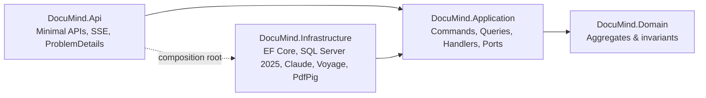
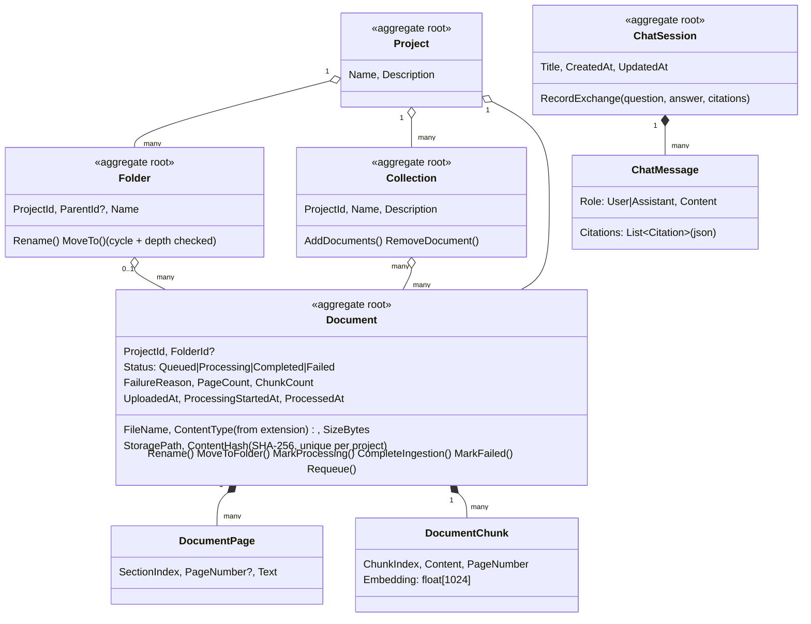
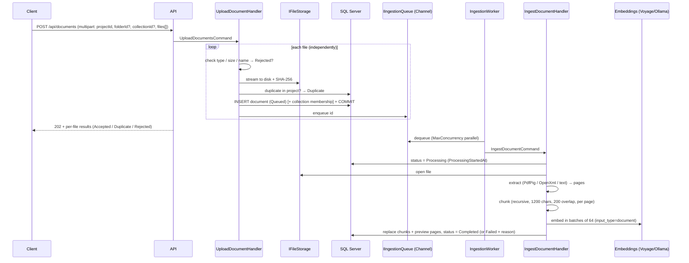
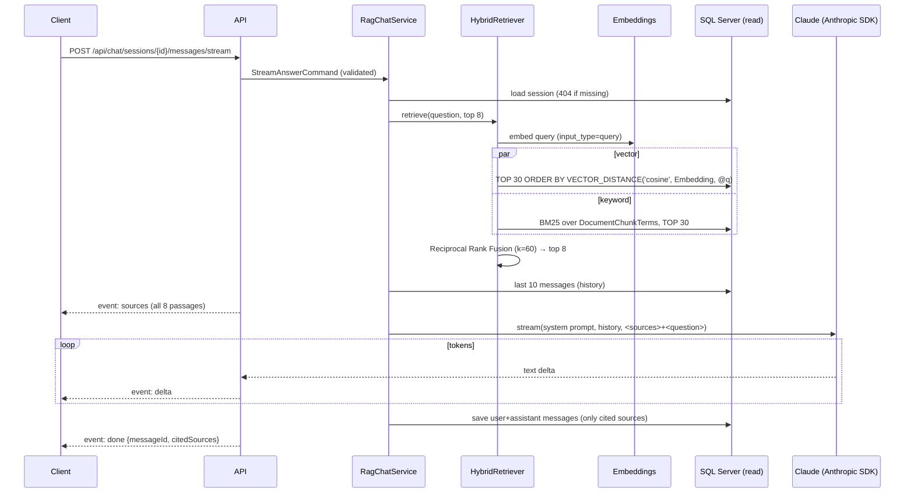

# DocuMind — Architecture & System Design

AI-powered document search and Retrieval-Augmented Generation (RAG) assistant.
Users upload documents, then search them semantically or chat with an assistant
that answers **only from those documents** and cites the passages it used.

---

## 1. Goals and non-goals

| Goals | Non-goals (for v1) |
|---|---|
| Upload PDF / DOCX / TXT / MD — one file or a batch — and make them searchable within seconds | OCR for scanned PDFs |
| Organize documents into projects, nested folders and cross-cutting collections | Permissions per folder (projects and collections are the sharing units) |
| Secure accounts, role-based access (Admin / Manager / User), private and shared collections, audit trail | SSO / MFA (see §9.5) |
| Preview, download, rename, move and delete documents; track Queued → Processing → Completed / Failed | Version history of a document |
| Hybrid search (meaning + exact terms) over all documents | Multi-tenant (multi-organisation) isolation |
| Grounded chat answers with inline citations `[1]` and source cards | Fine-tuning or training models |
| Streaming answers (SSE) for a responsive UI | A frontend (the API is UI-agnostic) |
| Clean separation of reads and writes (CQRS) so each side can scale | Distributed workers (designed for, not built — see §8) |

---

## 2. Architectural style

**Clean Architecture + CQRS + vertical feature slices.**



* **Dependencies point inward.** Domain has no dependencies; Application defines *ports*
  (interfaces such as `ITextEmbeddingService`, `IChunkSearchService`, `IFileStorage`);
  Infrastructure provides the *adapters*. Swapping Voyage for Ollama, local disk for S3, or
  Claude for another model touches only Infrastructure.
* **Vertical slices.** Each use case lives in one file under `Application/Features/<Area>/`
  with its request, validator and handler side by side.

### 2.1 CQRS

| | Commands (write side) | Queries (read side) |
|---|---|---|
| Marker | `ICommand<T>` | `IQuery<T>` |
| Data access | Repositories + `IUnitOfWork` over **`AppDbContext`** (change-tracked) | **`IReadDbContext`** over `ReadDbContext` (no-tracking, read-only, `SaveChanges` throws) and raw T-SQL on the read connection |
| Connection | `ConnectionStrings:SqlServer` (primary) | `ConnectionStrings:SqlServerRead` (readable secondary; falls back to primary) |
| Returns | Ids / small results | DTOs projected in SQL — entities are never materialised |

Both DbContexts share one model definition (`DocuMindModel.Configure`) so the read side
cannot drift from the write side. Only `AppDbContext` owns migrations.

### 2.2 In-process mediator

A ~60-line dispatcher (`Abstractions/Messaging/Sender.cs`) instead of MediatR (now commercially
licensed). It resolves the single `IRequestHandler<TRequest,TResponse>` and wraps it in every
registered `IPipelineBehavior<,>`:

```
Request → LoggingBehavior → ValidationBehavior (FluentValidation) → Handler
```

Handlers are resolved lazily, inside the innermost delegate, so a request rejected by
validation never constructs its handler's dependency graph.

**Streaming as a command result.** `StreamAnswerCommand : ICommand<IAsyncEnumerable<ChatStreamEvent>>`.
Validation, the session lookup and retrieval run *inside* `Send` — before the HTTP response
starts — so a bad request still gets a clean `400`/`404` ProblemDetails. Only generation is
lazy, flowing token-by-token as the endpoint enumerates the stream.

---

## 3. Domain model

### 3.1 Organization: projects, folders, collections

| Concept | Shape | Purpose |
|---|---|---|
| **Project** | Top-level workspace. Every document belongs to exactly one. | Isolation boundary: duplicates are detected per project, a project-bound chat never retrieves outside it, and it is the natural unit for future per-tenant access control. |
| **Folder** | Tree inside a project (`ParentId`, max depth 10, unique sibling names). A document is in at most one folder, or at the project root. | Familiar file-browser hierarchy. Scoping a search or chat to a folder includes all subfolders. |
| **Collection** | Flat, named set inside a project; many-to-many with documents. | Cross-cutting curation ("Q3 board pack") without moving files. A document can be in any number of collections. |

Search and chat scopes combine with AND: `project ∧ folder-subtree ∧ collection ∧ explicit document ids`.



Invariants enforced in the domain:

* Ingestion lifecycle `Queued → Processing → Completed | Failed`; reprocessing only from `Completed`/`Failed`.
* A `Completed` document has ≥ 1 chunk; completing ingestion **replaces** all chunks and preview pages atomically.
* Renaming keeps the extension (it selects the extractor and the served content type); names with path separators or reserved characters are rejected.
* Folders cannot move into their own subtree, across projects, or beyond 10 levels.
* A chat exchange is always recorded as a **user + assistant pair**, keeping history strictly
  alternating (required by the Claude Messages API).

---

## 4. Data store: SQL Server 2025

One database holds relational data, vectors and the keyword index — no separate vector DB to keep
in sync, chunk deletes cascade transactionally, and the access check runs in the same query as the
similarity search. **SQL Server 2025 (or Azure SQL) is required** for the native `VECTOR` and `JSON` types
(EF Core runs at compatibility level 170). Local development uses **LocalDB**.

| Table | Notable columns / indexes |
|---|---|
| `Projects`, `ProjectMembers` | members keyed `(ProjectId, UserId)`, index `(UserId, ProjectId)` for "what can this user read" |
| `Folders` | self-FK `ParentId` with **NO ACTION** (SQL Server forbids self-referencing cascades; the app deletes subtrees, a project delete removes all its folders in one statement); unique `(ProjectId, ParentId, Name)` with no filter, so root names are unique too |
| `Collections` / `CollectionDocuments` / `CollectionShares` | unique `(ProjectId, Name)`; join tables cascade from both sides |
| `Documents` | FK `ProjectId`, `FolderId` (**restrict** — deletes go through the app so stored files are cleaned up); unique `(ProjectId, ContentHash)`; `(ProjectId, FolderId, UploadedAt)` |
| `DocumentPages` | extracted text per page/section for previews; unique `(DocumentId, SectionIndex)` |
| `DocumentChunks` | `Embedding VECTOR(1024)`; `TermCount` (chunk length for BM25); FK `ON DELETE CASCADE` |
| `DocumentChunkTerms` | the keyword **inverted index**: `(Term, ChunkId, Frequency)`, clustered on `(Term, ChunkId)` |
| `ChatSessions`, `ChatMessages` | `Citations` native `json`; `(SessionId, CreatedAt)` |
| `Users`, `UserSessions`, `AuditLog` | see §9; `AuditLog.Details` native `json` |

**Vector search** is an exact nearest-neighbour scan with `VECTOR_DISTANCE('cosine', …)`. DiskANN vector
indexes are not available on Express/LocalDB; an exact scan stays fast up to roughly 100k chunks. On full
SQL Server 2025 / Azure SQL, add `CREATE VECTOR INDEX … (METRIC = 'cosine', TYPE = 'diskann')` and switch
the query to `VECTOR_SEARCH` for approximate search at larger scale (§8).

**Keyword search** is Okapi BM25 (k1 = 1.2, b = 0.75) over `DocumentChunkTerms`, computed in T-SQL.
SQL Server Full-Text Search was deliberately not used: it is not available on LocalDB or Express (without
Advanced Services), so it would make keyword search depend on the edition. Terms come from `KeywordTokenizer`
(lower-case, split on non-letters/digits, English stop words removed, no stemming — exact terms are the
point; paraphrases are the vector side's job). The same tokenizer parses queries.

`Embeddings:Dimensions` must match the `VECTOR(N)` column. Changing embedding model/dimension
requires a migration and re-processing documents (`POST /api/documents/{id}/reprocess`).

---

## 5. Ingestion pipeline (write path)



Key decisions:

* **Asynchronous.** Uploads return `202` immediately; clients poll `GET /api/documents/status?ids=…` for the whole batch.
* **Batch semantics.** Each file is validated, stored and committed on its own, so one bad file never sinks the batch and
  earlier files survive a later failure. Batch-level limits (file count, total size) are validated up front.
* **Content type is derived from the extension**, never from the client's header, so a file can never be served back as
  something the browser would execute.
* **Commit, then enqueue.** The `documents` row is the durable source of truth. If the process
  dies between commit and enqueue, the worker's **startup recovery scan** re-queues every
  `Queued`/`Processing` document. The in-memory `Channel` can therefore be lossy.
* **Idempotent.** Duplicate queue entries are de-duplicated in-flight and the handler skips
  documents already `Completed`/`Failed`. Identical files (same SHA-256) in the same project return the existing document.
* **Chunking** splits on the coarsest boundary that fits (paragraph → line → sentence → word),
  packs pieces up to `ChunkSize` with `ChunkOverlap` carried over, and never crosses a page, so
  every chunk has one page number to cite.
* **Failure isolation.** Extraction/embedding errors mark that document `Failed` with a reason;
  the worker keeps going. Voyage calls use `AddStandardResilienceHandler` (retry with backoff on
  429/5xx, circuit breaker).

---

## 6. Retrieval & answer generation (read path)



* **Hybrid retrieval.** Vector search catches paraphrases; BM25 keyword search catches exact
  terms, product codes and names that embeddings blur. The two ranked lists are merged with
  **Reciprocal Rank Fusion** — rank-based, so no score normalisation between cosine similarity
  and BM25 scores is needed, and passages both retrievers agree on rise to the top. The two
  searches run in parallel on separate pooled connections.
* **Prompt.** A byte-stable system prompt (cache-friendly) instructs Claude to answer only from
  the numbered `<source>` passages, cite with `[n]`, say so when the answer isn't there, flag
  conflicts, and treat source text as data, not instructions (prompt-injection hygiene).
  History is replayed as plain Q/A text, without old sources, to keep the prompt small.
* **Citations.** After generation, `[n]` markers are parsed; only sources actually cited are
  persisted on the assistant message and reported in the `done` event.
* **No hits → no LLM call.** If retrieval finds nothing, a fixed "couldn't find that" answer is
  returned without spending tokens.
* **Model.** `claude-opus-5-5` via the official `Anthropic` C# SDK, always streamed,
  `effort` configurable (default `medium`). Server-side refusal **fallbacks** (`"default"`) are
  enabled so a policy decline is retried on a fallback model inside the same call.
* **Client disconnect** cancels generation and nothing half-written is persisted.

---

## 7. API surface

| Method | Route | Side | Purpose |
|---|---|---|---|
| POST | `/api/auth/register`, `/login`, `/refresh` | Command (public, rate-limited) | Account + tokens |
| POST / GET | `/api/auth/logout`, `/logout-all`, `/change-password`, `/me` | C / Q | Session management |
| GET / POST / PUT | `/api/admin/users[/{id}/role\|active]` | Admin | User administration |
| GET | `/api/audit-logs?projectId&actorId&action&resourceId&succeeded&from&to` | Query | Audit trail |
| GET / POST / PUT / DELETE | `/api/projects/{id}/members[/{userId}]` | Q / C | Project sharing (Owner) |
| GET / POST / DELETE | `/api/collections/{id}/shares[/{userId}]` | Q / C | Collection sharing |
| POST / GET | `/api/projects` | C / Q | Create (Manager+) / list yours (with your role and counts by status) |
| GET / PUT / DELETE | `/api/projects/{id}` (`?force=true`) | Q / C / C | Get, update, delete (must be empty unless forced) |
| GET / POST | `/api/projects/{id}/folders` | Q / C | Folder tree with document counts / create folder |
| PUT | `/api/folders/{id}/name`, `/api/folders/{id}/parent` | Command | Rename / move folder |
| DELETE | `/api/folders/{id}` (`?recursive=true`) | Command | Delete (must be empty unless recursive) |
| GET / POST | `/api/projects/{id}/collections` | Q / C | List / create collections |
| GET / PUT / DELETE | `/api/collections/{id}` | Q / C / C | Get, update, delete (documents kept) |
| POST / DELETE | `/api/collections/{id}/documents[/{documentId}]` | Command | Add documents / remove one |
| POST | `/api/documents` | Command | Batch upload (multipart `projectId`, `folderId?`, `collectionId?`, `files`) → `202` with per-file results |
| GET | `/api/documents?projectId&folderId&includeSubfolders&rootOnly&collectionId&status&search&sortBy&descending&page&pageSize` | Query | List / filter |
| GET | `/api/documents/status?ids=…` | Query | Batch status polling |
| GET | `/api/documents/{id}` | Query | Metadata and status |
| GET | `/api/documents/{id}/content?download=false` | Query | Download, or inline view for PDF/TXT/MD (sandboxed CSP, `nosniff`, range requests) |
| GET | `/api/documents/{id}/preview?page&pageSize` | Query | Extracted text by page/section (any format, incl. DOCX) |
| PUT | `/api/documents/{id}/name` | Command | Rename (extension kept) |
| POST | `/api/documents/move` | Command | Move documents to a folder or the project root |
| DELETE | `/api/documents/{id}` | Command | Delete row, chunks, pages, memberships, file |
| POST | `/api/documents/{id}/reprocess` | Command | Re-ingest |
| POST | `/api/search` | Query | Hybrid search, no LLM; scoped by project / folder / collection / documents |
| POST | `/api/chat/sessions` | Command | Start conversation (optionally bound to a project) |
| GET | `/api/chat/sessions?projectId` | Query | List conversations |
| GET | `/api/chat/sessions/{id}` | Query | Messages + citations |
| POST | `/api/chat/sessions/{id}/messages` | Command | Ask, full JSON answer |
| POST | `/api/chat/sessions/{id}/messages/stream` | Command | Ask, SSE: `sources` → `delta`* → `done` |
| GET | `/health`, `/openapi/v1.json`, `/scalar` | — | Health, OpenAPI, interactive docs |

Errors are RFC 9457 ProblemDetails: validation → 400, not found → 404, domain rule → 409.

---

## 8. Scaling path

The seams are already in place; each step is an adapter swap, not a rewrite.

| Pressure | Change |
|---|---|
| Read load | Point `ConnectionStrings:SqlServerRead` at an Always On readable secondary (`ApplicationIntent=ReadOnly`). |
| Multiple API instances | Replace `LocalFileStorage` with Blob/S3 `IFileStorage`. |
| Ingestion throughput | Replace `ChannelIngestionQueue` with Service Bus / RabbitMQ and run `IngestionWorker` as a separate worker service; add a transactional outbox. |
| Large corpora (≫100k chunks) | Move off Express/LocalDB to SQL Server 2025 Standard/Enterprise or Azure SQL, add a DiskANN `VECTOR INDEX` and use `VECTOR_SEARCH`; beyond that, a dedicated vector store behind `IChunkSearchService`. |
| Answer quality | Add a re-ranker stage after RRF inside `HybridRetriever`. |
| Cost | Cache query embeddings; prompt caching once the system prompt grows past the cache minimum. |

## 9. Security: authentication, authorization, audit

### 9.1 Authentication

* **Accounts** — ASP.NET Core Identity (`Users` table): PBKDF2 password hashing, unique email,
  passwords ≥ 10 chars with upper/lower/digit, **lockout after 5 failures for 15 min**.
  Login responses never reveal whether an email exists, is locked or is deactivated (the precise
  reason goes only to the audit log), and unknown emails still cost one hash so timing doesn't leak either.
* **Bootstrap** — the first account ever registered becomes Admin. `Auth:AllowSelfRegistration=false`
  closes self-registration afterwards; Admins then create accounts.
* **Tokens** — a 15-minute **JWT access token** (HS256; `sub`, `email`, `name`, `role`, `sid`) plus a
  **refresh token** backed by a `UserSessions` row. Refresh tokens are `{sessionId}.{256-bit secret}`;
  only a SHA-256 of the secret is stored. Every refresh **rotates** the token; presenting an
  already-rotated token is treated as theft and **revokes the session**.
* **Revocation is immediate** — on every request the JWT handler also checks that the token's session
  is still open and its user still active (cached ≤ 30 s, evicted at once on this instance). Logout,
  "log out everywhere", password change (signs out other sessions) and deactivation therefore take effect
  right away, and the `role` claim is replaced with the user's *current* role, so demotions apply within seconds.
* **Abuse** — `/api/auth/register|login|refresh` are rate-limited to 10 requests/min per IP.
* **Signing key** — `Auth:SigningKey` (≥ 32 bytes) must come from user-secrets or `Auth__SigningKey`;
  startup fails without it outside Development (Development generates a throwaway key).

### 9.2 Authorization model

| Layer | Roles | Grants |
|---|---|---|
| System role (`users.role`) | **Admin** | Everything, incl. user administration and the global audit log |
| | **Manager** | Create projects (as Owner) |
| | **User** | Only what is shared with them; can create private collections |
| Project role (`ProjectMembers`) | **Viewer** | Read, preview, download, search, chat |
| | **Editor** | + upload, rename, move, delete, reprocess; folders; project-wide collections |
| | **Owner** | + rename/delete project, manage members, read the project's audit log |
| Collection | **Private** / **Project** visibility + `CollectionShares` | Shared users can read the collection *and its documents* — even outside the project, which only a project Owner may grant |

A user can read a document **iff** they are an Admin, a member of its project, or it is in a collection shared with them.
Conversations are private to their owner (Admins included).

**Enforcement is layered and secure by default:**

1. **HTTP** — the authorization fallback policy requires an authenticated user on every endpoint;
   only auth endpoints, health and API docs opt out. `/api/admin/*` additionally requires the Admin policy.
2. **CQRS pipeline** — `AuthorizationBehavior` rejects any request from an anonymous caller unless its type
   is marked `IPublicRequest`; `ISystemRequest` (ingestion) can only be sent by the app itself;
   `[RequireRole(...)]` on a request type declares a minimum system role. This holds no matter which transport sends the request.
3. **Handlers** — every resource access goes through `IAccessControl` (`RequireProject/Folder/Document/CollectionAsync`).
   No access at all → **404** (so ids can't be probed); visible but not permitted → **403**, audited.
   Permission lookups always read the **primary** database, never a replica.
4. **Read side** — list queries compose `ReadableProjects / ReadableDocuments / VisibleCollections` into their SQL.
5. **Retrieval** — `IChunkSearchService` takes an `AccessPrincipal` as a **required** argument and the access predicate is
   part of every vector and keyword query; there is no way to retrieve without stating whose permissions apply, so the
   LLM never sees a passage the asker couldn't open themselves. Project-bound chats re-check membership on every question.

> Caveat: list queries use the read model; if `SqlServerRead` points at an asynchronous secondary, a just-removed member
> may still see list results for the replication lag. Point it at the primary (default) or a synchronous replica if that matters.

### 9.3 Audit log

Append-only `AuditLog` table (who, what, when, from where, outcome, project, details as `json`). Recorded events:

| Area | Actions |
|---|---|
| Auth | `auth.login`, `auth.login_failed` (with reason), `auth.logout`, `auth.logout_all`, `auth.refresh_token_reused`, `auth.password_changed`, `user.registered` |
| Admin | `user.role_changed`, `user.activated`, `user.deactivated` |
| Access | `access.denied` (every 403), `document.viewed`, `document.downloaded`, `document.previewed`, **`documents.retrieved`** (which documents' content a search or AI answer used, per project) |
| Content | `document.uploaded`, `document.deleted`, `document.renamed`, `document.moved`, `document.reprocessed`, `document.processed`, `document.processing_failed`, `folder.deleted`, `project.*`, `collection.*` |
| Sharing | `project.member_added`, `project.member_role_changed`, `project.member_removed`, `collection.shared`, `collection.unshared` |

Handlers record events only after they have happened (after the commit); `AuditBehavior` writes them when the
request ends — **also when it fails**, so denied access and bad logins are captured — using a separate INSERT on its
own connection, outside the request's unit of work. Read it at `GET /api/audit-logs` (Admins: everything;
project Owners: `?projectId=`).

### 9.4 Other hardening

* Inline previews are served with `Content-Security-Policy: sandbox` and `X-Content-Type-Options: nosniff`, and only for
  PDF / TXT / MD with server-chosen content types. Browsers can't attach bearer tokens to `<iframe src>`, so a SPA should
  `fetch` the file with the header and display a blob URL.
* API keys come from configuration / environment / user-secrets; never commit them.
* Upload allow-list by extension and size limit; stored paths are generated server-side and resolved with a traversal guard.

### 9.5 Next steps

* SSO (OpenID Connect / Entra ID) as an alternative login, mapping groups to roles.
* MFA (TOTP) — Identity's authenticator token provider plugs into the same login flow.
* Audit retention policy and export to a SIEM.
